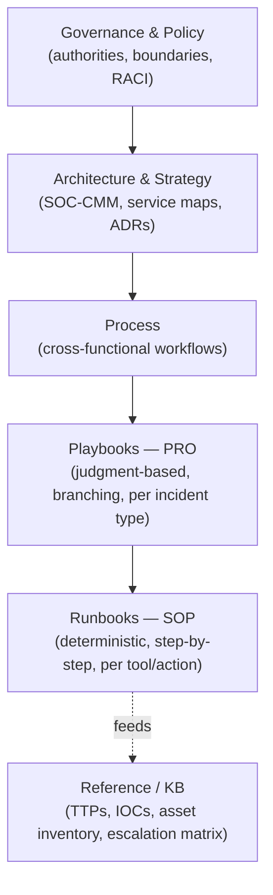

# Security Operations Documentation Library

A tier × domain matrix for SOC documentation. Every domain runs through the same tier stack, so a new domain (or a new hire) doesn't require learning a new taxonomy — only the scope changes.

## Why a matrix, not a pure pyramid

The [OSSOCDOCS pyramid](https://github.com/madirish/ossocdocs) (Runbooks → Process → Policy) is a good tier model, but folding every SOC domain into one flat pyramid produces a single "Runbooks" folder holding hundreds of unrelated SOPs. This library keeps the tier model and crosses it with a domain axis, so `detection-engineering/runbooks/` and `dfir/runbooks/` are separate, ownable, independently reviewable sets.

## Tier stack

| Tier | Answers | Changes how often |
|---|---|---|
| Governance | What's authorized? | Rarely |
| Architecture | Why is the SOC shaped this way? | Rarely |
| Process | How does work flow end to end? | Occasionally |
| Playbooks (PRO) | What judgment call applies to this scenario? | Occasionally |
| Runbooks (SOP) | What are the exact steps? | Often — tied to tool changes |
| Reference | What's the current lookup value? | Continuously |

## Domain pillars

Each folder under [`domains/`](./domains/) contains its own `process/ playbooks/ runbooks/ reference/`:

| Domain | Scope |
|---|---|
| [`threat-intel`](./domains/threat-intel/) | Adversary/TTP/IOC tracking (OpenCTI/MISP) — *what threats exist* |
| [`detection-engineering`](./domains/detection-engineering/) | Rule lifecycle, tuning, ATT&CK coverage — *how rules are built* |
| [`vulnerability-management`](./domains/vulnerability-management/) | Vuln discovery, prioritization, fused threat context |
| [`infrastructure-engineering`](./domains/infrastructure-engineering/) | Log/data pipeline plumbing and source onboarding |
| [`incident-response`](./domains/incident-response/) | Scenario playbooks — phishing, ransomware, account compromise, exfil |
| [`dfir`](./domains/dfir/) | Evidence handling, chain of custody — evidentiary rigor, not response decisions |
| [`iam-nhi`](./domains/iam-nhi/) | Identity, including non-human/agent credential lifecycle |
| [`data-log-management`](./domains/data-log-management/) | Source inventory, retention, visibility-gap catalog |
| [`agentic-ops`](./domains/agentic-ops/) | AI agent architecture, escalation rules, agent governance |
| [`tooling`](./domains/tooling/) | Vendor/tool setup and integration guides cutting across domains |

## Pillars outside the domain matrix

Some content doesn't belong to one domain or doesn't need the full tier treatment:

| Pillar | Purpose |
|---|---|
| [`governance/`](./governance/) | Charter, RACI, authorization boundaries |
| [`architecture/`](./architecture/) | SOC-CMM, service map, ADRs — the "SOC Architecture" pillar |
| [`metrics/`](./metrics/) | KPIs, SOC-CMM scorecards, exec reporting |
| [`grc/`](./grc/) | Compliance framework crosswalk |
| [`vendor-mdr/`](./vendor-mdr/) | Vendor/MDR SLAs and escalation contacts |
| [`training-tabletop/`](./training-tabletop/) | Onboarding + tabletop scenario library |
| [`comms-templates/`](./comms-templates/) | Breach notification / exec comms templates |
| [`change-management/`](./change-management/) | How docs and detections get reviewed and shipped |
| [`business-continuity/`](./business-continuity/) | Degraded-mode ops if SOC tooling itself is down |

## Metadata layer

Every doc opens with a YAML frontmatter block — see [`_templates/FRONTMATTER-SCHEMA.md`](./_templates/FRONTMATTER-SCHEMA.md). The field worth reading closely is `agent_executable`: it forces an explicit, doc-by-doc call on whether a given procedure is deterministic enough for an agent to run unsupervised, or whether it stays a human judgment call. That distinction is the same one any IR agent's system prompt needs — encoding it in the docs means it doesn't have to be re-derived separately.

## Starting a new doc

1. Pick the domain (or a cross-cutting pillar) and the tier.
2. Copy the matching template from [`_templates/`](./_templates/).
3. Fill frontmatter first — an incomplete frontmatter block is a stronger review flag than an incomplete body.
4. Link `related_docs` both directions where possible (a runbook should point up to its playbook/process; the playbook/process should point down to it).
