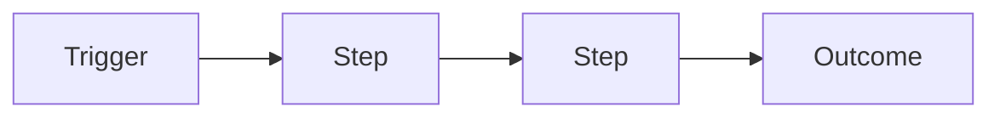

---
title:
doc_type: process
domain:
owner:
status: draft
last_reviewed:
review_cadence_days: 180
applicable_tools: []
related_docs: []
agent_executable: false
sensitivity: internal
---

# {Process Title}

## Purpose

The SOC function this process supports, and why it exists as a named process rather than an implicit habit.

## Workflow

Narrate the flow in prose too — who owns each step, and which playbook or runbook is invoked at each stage.

## Roles

| Role | Responsibility in this process |
|---|---|
| | |

## Inputs / Outputs

- **Inputs:** what starts this process (a ticket, a scheduled trigger, an intel feed update)
- **Outputs:** what this process produces and where it lands (a report, a closed ticket, an updated reference doc)

## Related docs

- Playbooks/runbooks invoked:
- Governance policy this process operates under:
